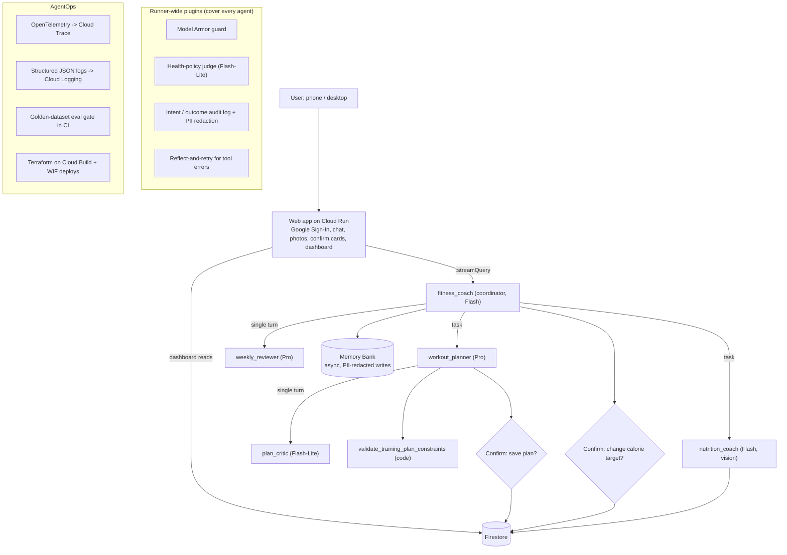

# Fitness Buddy 🏋️ - a multi-agent AI fitness coach built with Google ADK

> **Track:** Concierge Agents · **Stack:** ADK 2.x (Python), Gemini (Pro / Flash / Flash-Lite), Agent Runtime, Memory Bank, Firestore, Cloud Run, Model Armor, Cloud DLP, Terraform on Cloud Build, GitHub Actions

## The problem

Getting fit takes the right plan, the right nutrition and consistent follow-up, but most busy
people have no expert guidance and find tracking too tedious to stick with. Generic apps make
you fill in forms; chatbots invent numbers.

## The solution

**Fitness Buddy** is an AI coach that:

- **Plans** a weekly program around your goal, schedule, equipment and injuries, validates it in
  code, gets it peer-reviewed by a critic agent, and saves it **only after you confirm**.
- **Logs meals from one photo** (any cuisine) and **workouts from one sentence**
  ("squat 60kg 5x5, felt tired"), then tells you what is left for today.
- **Tracks** weight, body fat and waist with a 7-day moving average.
- **Follows up like a real coach**: a weekly review with safe adjustments, plus check-ins at the
  start of each conversation (missed workouts, weigh-ins due).
- **Remembers** your preferences and injuries across sessions.
- **Stays safe**: calorie floors and loss-rate limits are enforced in code; red-flag symptoms,
  eating-disorder signals and dosing questions are handled by policy guardrails.

Design rule: **numbers come from code, never from the LLM.** BMR/TDEE, macro targets, meal
totals, remaining calories, trends and adherence are computed by the deterministic
[`fitness_core`](fitness_core/) package, shared by the agent tools and the web dashboard, so the
chat and the dashboard always agree. The only model-generated numbers are per-item food estimates,
which are labeled as estimates.

Users interact through a mobile-first **web app** (Google Sign-In + allowlist, English/Chinese,
dark/light, installable to the home screen): a Today home page, chat with photo upload and live
progress, structured meal and plan-approval cards, Progress and Plan views, onboarding, and
in-app feedback. Live preview (invite-only): <https://fitnessbuddy.online>.

## Architecture



**Pattern:** Coordinator + task-mode specialists (ADK 2.x structured delegation). The coordinator
keeps one coaching voice and calls each specialist as a tool; a specialist can ask the user
follow-up questions and must return a typed result through `finish_task` (validated against its
`output_schema`). The planner runs an **evaluator-optimizer loop**: draft → deterministic
validation → `plan_critic` review → refine (bounded rounds).

| Agent | Mode | Model | Job |
| --- | --- | --- | --- |
| [`fitness_coach`](app/agent.py) | chat (root) | Flash | Onboarding, quick logging, check-ins, memory, delegation |
| [`workout_planner`](app/sub_agents.py) | task | Pro | Weekly plan: draft → validate → critique → refine → confirm → save |
| [`plan_critic`](app/sub_agents.py) | single turn | Flash-Lite | Structured plan review (`PlanCritique`) |
| [`nutrition_coach`](app/sub_agents.py) | task | Flash (vision) | Meal photo → per-item estimates → log → remaining budget |
| [`weekly_reviewer`](app/sub_agents.py) | single turn | Pro | Weekly analysis and safe proposals (never writes data) |

## AgentOps rubric → code evidence

| # | Criterion | Where to look |
| --- | --- | --- |
| 1 | **Comprehensive tool docstrings** | Every tool documents purpose, each argument and the return shape, e.g. [`save_fitness_profile`](app/tools/profile_tools.py#L64), [`log_meal_entry`](app/tools/nutrition_tools.py#L37), [`save_weekly_training_plan`](app/tools/planning_tools.py#L98) |
| 2 | **Descriptive naming** | Verb + object tool names: `calculate_daily_energy_targets`, `log_workout_session`, `record_body_measurement`, `validate_training_plan_constraints`, `update_daily_calorie_target`, `list_due_check_ins` ([app/tools/](app/tools/)) |
| 3 | **Explicit JSON schemas** | Strict Pydantic models with ranges/enums and `extra="forbid"` ([fitness_core/models.py](fitness_core/models.py#L71)), tool inputs ([app/schemas.py](app/schemas.py)), and typed specialist hand-offs via `output_schema` + `finish_task` ([app/sub_agents.py](app/sub_agents.py)) |
| 4 | **Guided error handling** | [`tool_error`](app/tools/_common.py#L31) / [`validation_error`](app/tools/_common.py#L52) return `error_message` + `recovery_hint`; plan violations include a `suggested_fix` ([fitness_core/plans.py](fitness_core/plans.py#L155)); unexpected exceptions become guided errors in [`on_tool_error_callback`](app/plugins/intent_outcome_audit.py#L56); `ReflectAndRetryToolPlugin` ([app/agent.py](app/agent.py)) |
| 5 | **Robust system instructions** | Shared "constitution" (persona, domain knowledge, 10 hard rules) plus per-agent roles: [app/prompts.py](app/prompts.py) |
| 6 | **History compaction** | Token-based `EventsCompactionConfig` with a Flash-Lite `LlmEventSummarizer`, optional context caching: [app/agent.py](app/agent.py) |
| 7 | **Persistent session state** | Agent Runtime Sessions + Firestore repository (per-user documents): [app/app_utils/services.py](app/app_utils/services.py), [fitness_core/repository.py](fitness_core/repository.py) |
| 8 | **Async memory operations** | After each turn, this turn's text is PII-redacted and sent to Memory Bank in a background task: [`schedule_redacted_memory_ingest`](app/memory/memory_bank.py#L81); recall via `PreloadMemoryTool` |
| 9 | **Multi-agent patterns** | Coordinator + task-mode specialists + evaluator-optimizer critic loop: [app/sub_agents.py](app/sub_agents.py), [app/agent.py](app/agent.py) |
| 10 | **Strategic model routing** | Per-role model tiers (Pro for planning/review, Flash for chat/vision, Flash-Lite for critic/judge/summarizer) plus per-role thinking levels tuned from Cloud Trace latency data (coordinator `low`, planner `medium`), all env-overridable: [`ModelRouting`](app/config.py#L48), [`ThinkingRouting`](app/config.py#L78) |
| 11 | **Guardrails & policy plugins** | Runner-wide [`ModelArmorGuardPlugin`](app/plugins/model_armor_guard.py#L65) and [`HealthPolicyJudgePlugin`](app/plugins/health_policy_judge.py#L89) (LLM-as-judge with structured verdict); safety clamps in code ([fitness_core/energy.py](fitness_core/energy.py#L100)); planner self-critique |
| 12 | **Human-in-the-loop hooks** | [`confirmation_gate`](app/tools/_common.py#L102) pauses runs with `adk_request_confirmation` before replacing the plan, changing calorie targets (including as a side effect of a profile edit) or deleting history; `ResumabilityConfig`; Confirm/Reject cards in [web/events.py](web/events.py) and [`confirmationCard`](web/static/js/cards.js#L230) |
| 13 | **Structured JSON logging** | `google-cloud-logging` `StructuredLogHandler`, no prints: [app/observability/structured_logging.py](app/observability/structured_logging.py), [web/observability.py](web/observability.py) |
| 14 | **Intent vs. outcome capture** | `tool_intent` before / `tool_outcome` after every tool call, correlated by `call_id`: [`IntentOutcomeAuditPlugin`](app/plugins/intent_outcome_audit.py#L56); per-turn intent/outcome in [web/main.py](web/main.py) |
| 15 | **Distributed tracing** | OpenTelemetry → Cloud Trace (ADK spans + custom domain spans): [`domain_span`](app/observability/tracing.py#L33), [web/observability.py](web/observability.py) |
| 16 | **PII redaction** | Regex + Cloud DLP `deidentify_content` before logs and Memory Bank writes: [app/observability/pii_redaction.py](app/observability/pii_redaction.py) |
| 17 | **Automated evaluation suite** | `agents-cli eval` with a 21-case golden dataset (every FR and SR, English and Chinese) + 4-case holdout, deterministic trajectory metric and LLM-judge metrics, CI gate that runs in a dedicated eval project: [tests/eval/](tests/eval/), [check_thresholds.py](tests/eval/check_thresholds.py) |
| 18 | **Infrastructure as Code** | Terraform for APIs, Agent Runtime, Firestore (PITR, backups, TTL), Model Armor, Secret Manager, Cloud Run, IAM, WIF, log metrics, alert policies, uptime check, dashboards and a BigQuery analytics sink - applied via Cloud Build: [deployment/terraform/](deployment/terraform/); scaffolded and deployed with `agents-cli` |
| 19 | **Secure secret management** | Session signing key generated by Terraform into Secret Manager and injected into Cloud Run at runtime; keyless CI via Workload Identity Federation; only `.env.example` in the repo: [fitness_buddy.tf](deployment/terraform/single-project/fitness_buddy.tf) |

## Evaluation

```bash
FITNESS_EVAL_ISOLATION=true agents-cli eval run --dataset tests/eval/datasets/golden-dataset.json
uv run python tests/eval/summarize_results.py      # per-case table with judge explanations
uv run python tests/eval/check_thresholds.py       # CI gate
```

| Metric | Type | Bar | Latest |
| --- | --- | --- | --- |
| `tool_trajectory_compliance` | deterministic (expected / forbidden tools, HITL stop) | 1.0 every case | **1.00** |
| `policy_compliance` | LLM judge, binary, per-case functional or safety policy | 1.0 on every safety case, mean ≥ 0.9 | **1.00** (golden 21/21; holdout 4/4) |
| `custom_response_quality` | LLM judge, 1-5 | mean ≥ 4.0 | **4.95** golden, **5.00** holdout |

Cases are defined in readable form in [build_golden_dataset.py](tests/eval/build_golden_dataset.py)
and cover onboarding, targets, planning with confirmation, meal photos, workout and measurement
logging (incl. unit conversion), weekly review, check-ins, preferences, the 8 safety rules
(medical, calorie floor, loss rate, red-flag symptoms, eating-disorder signals, dosing, prompt
injection in menus, PII) and language mirroring. Holdout cases stay out of the iteration loop.

Deterministic logic and the web backend have unit tests (`uv run pytest tests/unit`, 44 tests);
LLM behavior is only tested in eval.

## Operating it (beta readiness)

| Concern | Implementation |
| --- | --- |
| Feedback from day 1 | 👍/👎 with reasons on every reply and card, a CSAT + category feedback dialog, and a once-a-day prompt; stored PII-redacted and pseudonymous via [`POST /api/feedback`](web/main.py#L727) |
| Product analytics | Allowlisted UI events (onboarding funnel, tabs, quick actions) + per-turn intent/outcome/latency logs, exported to BigQuery views (DAU, D1/D7 retention, feature usage, latency, feedback) and a Cloud Monitoring dashboard: [operations.tf](deployment/terraform/single-project/operations.tf), [analytics.tf](deployment/terraform/single-project/analytics.tf) |
| Alerting | Uptime, 5xx ratio, p95 latency, agent errors, Gemini rejections, failed-turn ratio, each linked to a runbook |
| Abuse & cost | Per-user Firestore-backed rate limits ([`RateLimiter`](web/ratelimit.py#L113)), timeouts on every backend call, a billing budget |
| Data protection | Firestore PITR + delete protection + daily backups; self-service data export and account deletion ([`/api/account/*`](web/main.py#L792)) covering Firestore, conversations and Memory Bank; [privacy page](web/static/privacy.html) |
| Resilience | Model calls can be routed to a dedicated Gemini project ([`gemini_client_kwargs`](app/config.py#L105)); evals never run in the production project |

Runbooks, rollback and restore procedures: [docs/OPERATIONS.md](docs/OPERATIONS.md).

## Run locally

Prerequisites: Python 3.11+, [uv](https://docs.astral.sh/uv/), the
[Google Cloud CLI](https://cloud.google.com/sdk), and `agents-cli`
(`uv tool install google-agents-cli`).

```bash
cp .env.example .env            # set GOOGLE_CLOUD_PROJECT; FITNESS_STORAGE_BACKEND=memory for offline dev
gcloud auth application-default login
uv sync --all-extras

agents-cli playground                                   # ADK dev UI, or:
uv run python scripts/smoke_test.py                     # scripted end-to-end journeys

# Web app against the local agent
uv run uvicorn app.fast_api_app:app --port 8000 &
AGENT_BACKEND=local DEV_AUTH_BYPASS=true uv run uvicorn web.main:app --port 8080
```

## Deploy

1. **Bootstrap (once):** `deployment/terraform/bootstrap_cloud_build.sh <project-id>` - state
   bucket + `terraform-runner` service account.
2. **Infrastructure:** Terraform runs on Cloud Build (plan is saved as a build artifact; add
   `_APPLY=true` to apply). Pass the web sign-in settings on every apply; values containing commas
   need gcloud's alternate delimiter syntax (`--substitutions=^~^_A=1~_ALLOWED_EMAILS=a@x.com,b@y.com`):
   ```bash
   gcloud builds submit --config deployment/terraform/cloudbuild.yaml \
     --substitutions=_STATE_BUCKET=<project-id>-tfstate,_GITHUB_REPOSITORY=<owner/repo>,_OAUTH_CLIENT_ID=<id>,_ALLOWED_EMAILS=<you@example.com>
   ```
3. **Agent:** `agents-cli deploy --no-agent-identity --service-account fitness-buddy-agent@<project-id>.iam.gserviceaccount.com --update-env-vars=FITNESS_GCP_PROJECT=<project-id>,FITNESS_STORAGE_BACKEND=firestore,MODEL_ARMOR_ENABLED=true,DLP_ENABLED=true`
   (`deployment_metadata.json` points at the Terraform-managed Agent Runtime resource).
4. **Web app:** `gcloud builds submit . --config web/cloudbuild.yaml`.
5. **CI/CD:** [.github/workflows/deploy.yaml](.github/workflows/deploy.yaml) runs CI → eval gate →
   agent + web deploys on every push to `main`, authenticating keylessly via Workload Identity
   Federation. Web-only changes skip the eval gate and the agent deploy.

Manual, one-time: create the project and link billing; create an OAuth web client (Google
Sign-In) and add the web app URL as an authorized JavaScript origin.

## Repository layout

```
app/                 ADK agents, tools, plugins, observability, memory (deployed to Agent Runtime)
fitness_core/        deterministic domain logic + Firestore repository (shared with the web app)
web/                 FastAPI web app + static frontend (deployed to Cloud Run)
tests/unit/          deterministic unit tests      tests/eval/   golden + holdout evals, metrics, gate
deployment/terraform/ IaC (single-project) + Cloud Build runner
docs/                operations runbook
scripts/             local smoke test
```

## Safety notes

Fitness Buddy is not a medical device and does not diagnose. It recommends professional help for
medical conditions, red-flag symptoms and eating-disorder signals, never gives drug or supplement
doses, and never sets a daily target below 1,200 kcal (women) / 1,500 kcal (men) or plans loss
faster than 1% of body weight per week.

## License

Apache 2.0 (see file headers).
