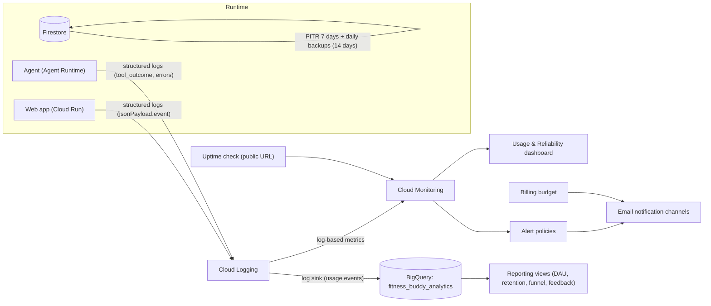

# Fitness Buddy operations guide

How Fitness Buddy is monitored, how to respond to each alert, and how to answer
product questions (usage, feedback, retention) from the data we collect.

All infrastructure below is Terraform in
[`deployment/terraform/single-project`](../deployment/terraform/single-project)
(files `operations.tf`, `analytics.tf`, `fitness_buddy.tf`), applied through
Cloud Build (`deployment/terraform/cloudbuild.yaml`). Placeholders used in the
commands:

| Placeholder | Meaning |
| --- | --- |
| `$PROJECT` | Main Google Cloud project (web app, agent, Firestore) |
| `$REGION` | Deployment region (e.g. `us-east1`) |
| `$ENGINE_ID` | Numeric Agent Runtime (reasoning engine) id of the agent |
| `$PROJECT_NUMBER` | Project number of `$PROJECT` |
| `$GEMINI_PROJECT` | Project that serves Gemini calls, when different from `$PROJECT` |
| `$BILLING_ACCOUNT` | Billing account id |
| `$REPO` | GitHub repository (`owner/name`) |

Sensitive values (alert recipients, allowed users, OAuth client id, public
hostname) are **never committed**; they are passed as Cloud Build
substitutions (`_ALERT_EMAILS`, `_ALLOWED_EMAILS`, `_OAUTH_CLIENT_ID`,
`_UPTIME_HOST`).

---

## 1. Operations architecture



| Signal | Source | Where to look |
| --- | --- | --- |
| Availability | Uptime check on `https://<public host>/` (variable `uptime_path`) every 5 min | Monitoring > Uptime checks |
| Request errors / latency | Cloud Run built-in metrics | Dashboard "Reliability" section |
| Chat quality | `chat_turn` log events (intent, outcome, latency) | Log-based metrics `chat_turns`, `chat_turn_latency` |
| Agent health | Agent Runtime logs with severity >= ERROR | Log-based metric `agent_errors` |
| Model access | `403 PERMISSION_DENIED` / `429 RESOURCE_EXHAUSTED` / policy rejections | Log-based metric `gemini_rejections` |
| Engagement | `sign_in`, `ui_event`, `user_feedback`, `rate_limited` events | Dashboard + BigQuery views |
| Cost | Billing budget (actual 50 / 90 / 100 %, forecast 100 %) | Billing > Budgets & alerts |

### Log-based metrics

| Metric | Filter (summary) | Labels |
| --- | --- | --- |
| `chat_turns` | web, `jsonPayload.event="chat_turn"` | `intent`, `outcome` |
| `chat_turn_latency` | web, `chat_turn`, distribution of `jsonPayload.latency_ms` | `intent` |
| `web_errors` | web, `severity>=ERROR` | `event` |
| `agent_errors` | agent, `severity>=ERROR` | – |
| `gemini_rejections` | web or agent, text contains `403 PERMISSION_DENIED`, `429 RESOURCE_EXHAUSTED` or `Request rejected in accordance` | – |
| `user_feedback` | web, `user_feedback` | `rating`, `kind` |
| `sign_ins` | web, `sign_in` | `outcome` |
| `rate_limited` | web, `rate_limited` | `scope` |
| `ui_events` | web, `ui_event` | `name` |

Metric names in Monitoring are `logging.googleapis.com/user/<name>`. Log-based
metrics only count entries written **after** the metric was created.

### Dashboard

Monitoring > Dashboards > **Fitness Buddy - Usage & Reliability**: turns per
day by intent, sign-ins per day (DAU proxy), outcome breakdown, latency
p50/p95 by intent, feedback up vs down, onboarding funnel, UI events by name,
rate limiting, web 5xx, web error logs, agent errors, Gemini rejections,
Cloud Run instances, Agent Runtime requests and latency. Distinct users cannot
be counted with metrics; use the BigQuery views (section 5) for true DAU.

---

## 2. Alert runbooks

Every alert policy links to the matching section below. General first steps
for any alert:

1. Open the dashboard and check *when* the problem started and whether it
   correlates with a deploy (GitHub Actions run, new Cloud Run revision, new
   agent version label `service.version` in the agent logs).
2. Read recent errors:
   ```bash
   # Web app
   gcloud logging read 'resource.type="cloud_run_revision" AND resource.labels.service_name="fitness-buddy-web" AND severity>=WARNING' \
     --project "$PROJECT" --freshness 1h --limit 50
   # Agent
   gcloud logging read "resource.labels.reasoning_engine_id=\"$ENGINE_ID\" AND severity>=ERROR" \
     --project "$PROJECT" --freshness 1h --limit 20
   ```
3. If a deploy caused it, roll back (see [Rollback](#rollback-procedures)).

### Site down (uptime check)

> Cloud Run reserves URL paths ending in `z`: `/healthz` is answered by
> Google's edge with a 404 and never reaches the app. Do not point the uptime
> check at it; use `/` or a non-`z` path such as `/health`.

**Meaning:** `GET <uptime_path>` (default `/`) on the public domain failed from more than one
checker region for 10 minutes.

**First checks**
- `curl -i https://<public host>/` and the Cloud Run URL
  (`gcloud run services describe fitness-buddy-web --region "$REGION" --project "$PROJECT" --format='value(status.url)'`).
  If only the custom domain fails, check the domain mapping / DNS / certificate.
- `gcloud run services describe fitness-buddy-web ...` — is the latest
  revision `Ready`? Container crash loops show in the revision logs.
- Google Cloud status page for Cloud Run in `$REGION`.

**Mitigation:** roll back to the last good revision; if the image is fine but
the service config broke, re-apply Terraform.

### Cloud Run 5xx ratio

**Meaning:** more than 5 % of web requests returned 5xx over 10 minutes.

**First checks:** dashboard tile "Web error logs by event" tells which code
path fails: `agent_turn_exception` (agent unreachable), `dashboard_failed` /
`open_session_failed` (Firestore or Agent Runtime sessions), or uncaught
exceptions. Check the Cloud Run request logs for the failing paths.

**Mitigation:** roll back the web revision if it started with a deploy. If the
agent is failing, follow [Agent errors](#agent-errors). If Firestore is
failing, check IAM (`roles/datastore.user` on the web service account) and the
Firestore status.

### Slow chat turns

**Meaning:** p95 of `chat_turn` latency (as seen by the web app) exceeded
120 s over 15 minutes.

**First checks**
- Dashboard: is it all intents or one (e.g. weekly review, which calls a
  sub-agent)? Compare with "Agent Runtime request latency".
- Cloud Trace: open a slow `fitness_buddy.web.agent_turn` span and see which
  tool / model call dominates.
- Agent Runtime instance pressure (`reasoning_engine/cpu/allocation_time`);
  Gemini `429` responses (see [Gemini rejected requests](#gemini-rejected-requests)).

**Mitigation:** raise Agent Runtime `min_instances` / `max_instances`
(agents-cli deploy flags), reduce the thinking budget of the slow agent, or
roll back the agent to the previous tag.

### Agent errors

**Meaning:** the agent logged more than 5 ERROR entries in 10 minutes.

**First checks:** read the agent errors (command above). Typical causes:
- Gemini errors (`403`, `429`) → [Gemini rejected requests](#gemini-rejected-requests).
- Firestore / Model Armor / DLP permission errors → verify the agent service
  account roles (`fitness-buddy-agent@...`, see `fitness_buddy.tf`).
- A regression in a tool → roll back the agent.

### Gemini rejected requests

**Meaning:** at least one Gemini call returned `403 PERMISSION_DENIED`,
`429 RESOURCE_EXHAUSTED` or `Request rejected in accordance with our terms of
use and policies` in the last 5 minutes. Users usually cannot chat at all.

**First checks**
- Read the matching log lines:
  ```bash
  gcloud logging read "resource.labels.reasoning_engine_id=\"$ENGINE_ID\" AND (textPayload:\"403 PERMISSION_DENIED\" OR textPayload:\"429 RESOURCE_EXHAUSTED\" OR textPayload:\"Request rejected in accordance\")" \
    --project "$PROJECT" --freshness 1h --limit 5
  ```
- `429 RESOURCE_EXHAUSTED`: quota / capacity. Check Vertex AI quotas for the
  model in the Gemini project; retry/backoff is built in, so sustained 429s
  mean the quota must be raised or traffic shed.
- `403 ... Request rejected in accordance with our terms of use`: the project's
  Gemini access has been restricted (abuse/policy enforcement). Check the
  project's email and the Cloud console notifications; file an appeal.
- `403 PERMISSION_DENIED` (other message): IAM. Verify `roles/aiplatform.user`
  for the agent service account in the project that serves Gemini.

**Mitigation: switch the Gemini project.** The agent reads `GEMINI_PROJECT`
(model calls only; Firestore, sessions and Memory Bank stay in `$PROJECT`):
1. Pick a healthy project with Vertex AI enabled (`$GEMINI_PROJECT`).
2. Grant `roles/aiplatform.user` (and `roles/serviceusage.serviceUsageConsumer`)
   in `$GEMINI_PROJECT` to: the agent service account, the CI deployer service
   account, and the Reasoning Engine service agent
   `service-$PROJECT_NUMBER@gcp-sa-aiplatform-re.iam.gserviceaccount.com`
   (Memory Bank generation runs as it).
3. Set the GitHub variable and redeploy:
   ```bash
   gh variable set GEMINI_PROJECT --body "$GEMINI_PROJECT" --repo "$REPO"
   gh workflow run deploy.yaml --repo "$REPO"
   ```
4. Point Memory Bank generation at the new project (see the revert section
   for the API shape; use the full model resource name in `$GEMINI_PROJECT`).

Evals intentionally send unsafe prompts (eating disorders, drug dosing, prompt
injection). They run in a **dedicated eval project** (GitHub variable
`EVAL_GEMINI_PROJECT`) so that safety testing can never trigger enforcement on
the production project. Never point `EVAL_GEMINI_PROJECT` at `$PROJECT`.

### Failed chat turns

**Meaning:** more than 20 % of chat turns ended with outcome `agent_error` or
`error` over 15 minutes (`ok` and `awaiting_confirmation` count as success).
The condition (PromQL) only fires when there were at least 3 turns in the
window, so a single failure at low traffic does not page.

**First checks:** dashboard "Chat turn outcomes" by outcome; then the web
`agent_turn_exception` logs and the agent errors. Usually a symptom of one of
the alerts above.

---

## 3. Rollback procedures

### Roll back the web app (Cloud Run)

```bash
gcloud run revisions list --service fitness-buddy-web --region "$REGION" --project "$PROJECT"
gcloud run services update-traffic fitness-buddy-web --region "$REGION" --project "$PROJECT" \
  --to-revisions <LAST_GOOD_REVISION>=100
```
Later deploys move traffic back to the latest revision automatically
(`--to-latest`).

### Redeploy the agent from a git tag

The Agent Runtime resource is created by Terraform with a placeholder and the
real code is deployed by `agents-cli deploy` (Terraform ignores the agent
`spec`, so a Terraform apply never replaces the running agent).

```bash
git fetch --tags && git checkout <TAG_OR_SHA>
printf '{"remote_agent_runtime_id": "projects/%s/locations/%s/reasoningEngines/%s", "deployment_timestamp": null}\n' \
  "$PROJECT_NUMBER" "$REGION" "$ENGINE_ID" > deployment_metadata.json
agents-cli deploy --project "$PROJECT" --region "$REGION" \
  --no-agent-identity \
  --service-account "fitness-buddy-agent@$PROJECT.iam.gserviceaccount.com" \
  --update-env-vars="<same env vars as .github/workflows/deploy.yaml>"
```
Alternatively re-run the *Eval gate and deploy* workflow on the tag
(`gh workflow run deploy.yaml --ref <TAG>`), which also re-runs the eval gate.

### Restore Firestore data

The `(default)` database has **point-in-time recovery** (7 days, 1-minute
granularity), **delete protection**, and a **daily backup** schedule kept for
14 days. Restores always go to a **new** database; then either point the app
at it or copy the needed documents back.

```bash
# Point-in-time clone (any minute in the last 7 days, UTC)
gcloud firestore databases clone --project "$PROJECT" \
  --source-database='projects/'"$PROJECT"'/databases/(default)' \
  --snapshot-time='2026-01-01T10:00:00Z' \
  --destination-database='restore-YYYYMMDD'

# From a daily backup
gcloud firestore backups list --project "$PROJECT" --location "$REGION"
gcloud firestore databases restore --project "$PROJECT" \
  --source-backup='projects/'"$PROJECT"'/locations/'"$REGION"'/backups/<BACKUP_ID>' \
  --destination-database='restore-YYYYMMDD'

# Export a single collection from the restored database and import it back
gcloud firestore export gs://<bucket>/restore --project "$PROJECT" \
  --database='restore-YYYYMMDD' --collection-ids='<collection>'
gcloud firestore import gs://<bucket>/restore/<export-folder> --project "$PROJECT" \
  --database='(default)' --collection-ids='<collection>'
```
Delete the temporary database afterwards (`gcloud firestore databases delete
--database=restore-YYYYMMDD`). Deleting `(default)` itself requires turning
delete protection off first, deliberately.

The `rate_limits` collection group has a TTL policy on `expire_at`: Firestore
deletes expired rate-limit documents automatically (usually within 24 h of
expiry). Restores never need to include this collection.

---

## 4. Temporary Gemini-project workaround and how to revert it

**Context:** the main project's Gemini access was suspended (policy
enforcement, most likely triggered by CI evals sending intentionally unsafe
prompts). Until the appeal is resolved, Gemini calls are served from another
project:

- GitHub variable `GEMINI_PROJECT` → passed to the agent at deploy time as the
  `GEMINI_PROJECT` env var (model calls only).
- Memory Bank generation model set to a model resource in that project.
- Cross-project `roles/aiplatform.user` bindings in the Gemini project for the
  agent service account, the CI deployer service account and the Reasoning
  Engine service agent.
- Evals now run in the dedicated eval project (`EVAL_GEMINI_PROJECT`); keep
  this even after reverting.

**Revert once the main project's Gemini access is restored** (verify first:
`curl` a `generateContent` call against the main project returns 200):

1. Remove the override and redeploy:
   ```bash
   gh variable delete GEMINI_PROJECT --repo "$REPO"
   gh workflow run deploy.yaml --repo "$REPO"
   ```
   Wait for the deploy to finish; confirm a chat turn works and
   `gemini_rejections` stays at 0.
2. Reset the Memory Bank generation model to the default (an empty model makes
   Agent Runtime use the project's default generation model):
   ```bash
   curl -X PATCH \
     -H "Authorization: Bearer $(gcloud auth print-access-token)" \
     -H "Content-Type: application/json" \
     "https://$REGION-aiplatform.googleapis.com/v1beta1/projects/$PROJECT/locations/$REGION/reasoningEngines/$ENGINE_ID?updateMask=contextSpec.memoryBankConfig.generationConfig.model" \
     -d '{"contextSpec": {"memoryBankConfig": {"generationConfig": {"model": ""}}}}'
   ```
   The call returns a long-running operation; check it completes, then read the
   engine back and confirm `contextSpec.memoryBankConfig.generationConfig`
   no longer references the other project.
3. Remove the three cross-project IAM bindings in `$GEMINI_PROJECT`:
   ```bash
   for MEMBER in \
     "serviceAccount:fitness-buddy-agent@$PROJECT.iam.gserviceaccount.com" \
     "serviceAccount:fitness-buddy-deployer@$PROJECT.iam.gserviceaccount.com" \
     "serviceAccount:service-$PROJECT_NUMBER@gcp-sa-aiplatform-re.iam.gserviceaccount.com"; do
     gcloud projects remove-iam-policy-binding "$GEMINI_PROJECT" \
       --member "$MEMBER" --role roles/aiplatform.user --condition=None
   done
   ```
   (Also remove `roles/serviceusage.serviceUsageConsumer` for the same members
   if it was granted.)
4. Check the dashboard for an hour: chat outcomes `ok`, no agent errors.

---

## 5. Product analytics (BigQuery)

A log sink (`fitness-buddy-analytics`) routes the web app's usage events
(`chat_turn`, `sign_in`, `open_session`, `user_feedback`, `ui_event`,
`rate_limited`, `account_export`, `account_deleted`, `agent_turn_exception`,
`dashboard_failed`) and the agent's `tool_outcome` events to the dataset
`fitness_buddy_analytics`:

| Table | Content |
| --- | --- |
| `run_googleapis_com_stderr` | Web events (day-partitioned on `timestamp`) |
| `aiplatform_googleapis_com_reasoning_engine_stderr` | Agent tool outcomes |

Users are identified only by the pseudonym the web app logs
(`jsonPayload.user`, a keyed hash of the account id); emails are never logged.
Chat previews (`jsonPayload.request`) are PII-redacted and truncated before
logging. Raw events expire after `analytics_retention_days` (default 30, matching
the privacy policy's 30-day log retention).

Field types are fixed by the table schema (`deployment/terraform/single-project/analytics/*.json`):
`latency_ms` FLOAT, `tags` repeated STRING, `has_comment` BOOLEAN, everything
else STRING. Log entries with a different type for an existing column are
written to an `export_errors` table instead; keep the web app's logging types
stable.

### Views

| View | Columns |
| --- | --- |
| `daily_active_users` | `day, active_users, chatting_users, chat_turns` |
| `turns_per_user_per_day` | `day, user_pseudonym, turns, failed_turns, avg_latency_ms` |
| `feature_usage` | `day, source (intent / ui / tool), feature, uses, distinct_users, distinct_sessions` |
| `latency_percentiles` | `day, intent, turns, p50_ms, p95_ms, max_ms` |
| `error_rate` | `day, turns, failed_turns, agent_error_turns, web_error_turns, turn_failure_rate, tool_calls, tool_errors, tool_error_rate` |
| `feedback` | `day, timestamp, user_pseudonym, kind, rating, tags, has_comment, lang` |
| `onboarding_funnel` | `day, started_users, step_users, completed_users, completion_rate` |
| `retention_d1_d7` | `cohort_day, cohort_users, d1_users, d7_users, active_d1_to_d7_users, d1_retention, d7_retention, week1_retention` |

### Ready-to-run queries

Run with `bq query --use_legacy_sql=false --project_id="$PROJECT" '<SQL>'` or in
the BigQuery console (replace `$PROJECT`).

```sql
-- DAU, last 30 days
SELECT * FROM `$PROJECT.fitness_buddy_analytics.daily_active_users`
WHERE day >= DATE_SUB(CURRENT_DATE(), INTERVAL 30 DAY) ORDER BY day DESC;

-- Weekly active users (distinct pseudonyms per ISO week)
SELECT DATE_TRUNC(DATE(timestamp), ISOWEEK) AS week, COUNT(DISTINCT jsonPayload.user) AS wau
FROM `$PROJECT.fitness_buddy_analytics.run_googleapis_com_stderr`
WHERE jsonPayload.user IS NOT NULL GROUP BY week ORDER BY week DESC;

-- Power users: turns per user over the last 7 days
SELECT user_pseudonym, SUM(turns) AS turns, COUNT(DISTINCT day) AS active_days
FROM `$PROJECT.fitness_buddy_analytics.turns_per_user_per_day`
WHERE day >= DATE_SUB(CURRENT_DATE(), INTERVAL 7 DAY)
GROUP BY user_pseudonym ORDER BY turns DESC LIMIT 20;

-- Most used features (intents, tools, UI events), last 7 days
SELECT source, feature, SUM(uses) AS uses
FROM `$PROJECT.fitness_buddy_analytics.feature_usage`
WHERE day >= DATE_SUB(CURRENT_DATE(), INTERVAL 7 DAY)
GROUP BY source, feature ORDER BY uses DESC;

-- Latency trend by intent
SELECT * FROM `$PROJECT.fitness_buddy_analytics.latency_percentiles` ORDER BY day DESC, intent;

-- Failure rate trend
SELECT day, turns, turn_failure_rate, tool_calls, tool_error_rate
FROM `$PROJECT.fitness_buddy_analytics.error_rate` ORDER BY day DESC;

-- Feedback: thumbs up ratio per day and most frequent tags on thumbs down
SELECT day, COUNTIF(rating = 'up') AS up, COUNTIF(rating = 'down') AS down,
       SAFE_DIVIDE(COUNTIF(rating = 'up'), COUNTIF(rating IN ('up', 'down'))) AS up_ratio,
       COUNTIF(has_comment) AS with_comment
FROM `$PROJECT.fitness_buddy_analytics.feedback` GROUP BY day ORDER BY day DESC;

SELECT tag, COUNT(*) AS n
FROM `$PROJECT.fitness_buddy_analytics.feedback`, UNNEST(tags) AS tag
WHERE rating = 'down' GROUP BY tag ORDER BY n DESC;

-- Onboarding funnel, all time
SELECT SUM(started_users) AS started, SUM(step_users) AS stepped, SUM(completed_users) AS completed,
       SAFE_DIVIDE(SUM(completed_users), SUM(started_users)) AS completion_rate
FROM `$PROJECT.fitness_buddy_analytics.onboarding_funnel`;

-- D1 / D7 retention by cohort (cohorts younger than 7 days are incomplete)
SELECT * FROM `$PROJECT.fitness_buddy_analytics.retention_d1_d7` ORDER BY cohort_day DESC;

-- Slowest / most failing agent tools, last 7 days
SELECT jsonPayload.tool AS tool, COUNT(*) AS calls,
       COUNTIF(jsonPayload.status != 'ok') AS errors,
       APPROX_QUANTILES(jsonPayload.latency_ms, 100)[OFFSET(95)] AS p95_ms
FROM `$PROJECT.fitness_buddy_analytics.aiplatform_googleapis_com_reasoning_engine_stderr`
WHERE jsonPayload.event = 'tool_outcome' AND DATE(timestamp) >= DATE_SUB(CURRENT_DATE(), INTERVAL 7 DAY)
GROUP BY tool ORDER BY calls DESC;
```

Sink health: Logging > Log Router shows sink errors; an `export_errors` table
in the dataset means a type mismatch (see above).

---

## 6. Budget and cost alerts

A monthly budget (default **100 USD**) covers the main project, the Gemini
project and the eval project, with email alerts at **50 %, 90 % and 100 % of
actual spend and 100 % of forecasted spend**, delivered to the same
notification channels as the alerts.

The budget is created **once, manually** with user credentials because the
Terraform runner has no billing-account permissions:

```bash
gcloud services enable billingbudgets.googleapis.com --project "$PROJECT"
# Notification channel ids: `terraform output alert_notification_channels`
# or: gcloud beta monitoring channels list --project "$PROJECT" --format='value(name)'
gcloud billing budgets create \
  --billing-account="$BILLING_ACCOUNT" \
  --display-name="Fitness Buddy monthly budget" \
  --budget-amount=100USD \
  --calendar-period=month \
  --filter-projects="projects/$PROJECT,projects/$GEMINI_PROJECT,projects/<eval project>" \
  --threshold-rule=percent=0.5 \
  --threshold-rule=percent=0.9 \
  --threshold-rule=percent=1.0 \
  --threshold-rule=percent=1.0,basis=forecasted-spend \
  --notifications-rule-monitoring-notification-channels="projects/$PROJECT/notificationChannels/<id-1>,projects/$PROJECT/notificationChannels/<id-2>" \
  --billing-project="$PROJECT"
gcloud billing budgets list --billing-account="$BILLING_ACCOUNT" --billing-project="$PROJECT"
```

Budgets only notify; they never stop spend. On an unexpected spike: check
Billing > Reports grouped by SKU (Gemini tokens, Agent Runtime vCPU, Cloud
Run), then `rate_limited` and `turns_per_user_per_day` for abuse, and lower
Agent Runtime `max_instances` if needed.

---

## 7. Data deletion and export requests

Users can export and delete their own data in the app (Settings). The web app
logs `account_export` / `account_deleted` events (pseudonym only).

**Logs and analytics events are kept for 30 days** (Cloud Logging default
bucket retention and the BigQuery partition expiration), as stated on the
privacy page.

Self-service deletion removes the user's Firestore documents and Agent Runtime
sessions / memories. Remaining copies, and how they age out:

| Copy | Retention | Action for an explicit erasure request |
| --- | --- | --- |
| Firestore PITR versions | 7 days | Ages out automatically |
| Firestore daily backups | 14 days | Ages out automatically (backups cannot be edited) |
| Cloud Logging (pseudonymous events, redacted previews) | Log bucket retention (default 30 days) | Ages out automatically |
| BigQuery analytics (pseudonymous) | 30 days (`analytics_retention_days`) | Delete rows by pseudonym (below) |

To delete one user's analytics rows (the pseudonym appears in the
`account_deleted` event or can be computed by the web app for the account):

```sql
DELETE FROM `$PROJECT.fitness_buddy_analytics.run_googleapis_com_stderr`
WHERE jsonPayload.user = '<pseudonym>';
```
(Rows streamed in the last ~30 minutes cannot be deleted yet; retry later.)
If a user cannot use self-service, an operator can run the same deletion code
path for their account id; record the request date and completion in the
support log.
